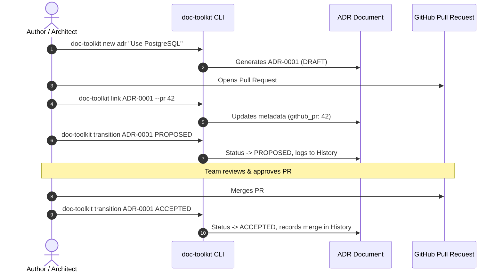
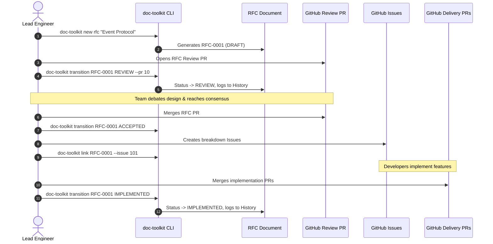
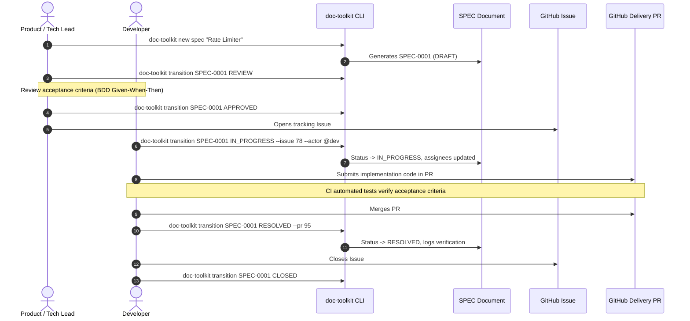

# Mapping Document Types to GitHub Tools

This document provides a comprehensive guide and architectural reference for how each documentation artifact (`ADR`, `RFC`, `SPEC`) in **gh-project-doc-toolkit** maps to native GitHub collaboration and execution tools (**Pull Requests**, **Issues**, **Discussions**, **Projects**, and **Milestones**).

---

## 1. Architectural Philosophy: Document-First Mapping

```
+-------------------------------------------------------------------------------+
|                       DOCUMENT-FIRST ARCHITECTURE                             |
|                                                                               |
|   [ Version-Controlled Document ]  ==== Maps to ===>  [ GitHub Platform Tools ] |
|   (Single Source of Truth)                            (Collaboration & Review)|
|                                                                               |
|   - adrs/ADR-XXXX-title.md         --------------->   - Pull Request (Review) |
|   - rfcs/RFC-XXXX-title.md         --------------->   - PR & Tracking Issues  |
|   - specs/SPEC-XXXX-title.md       --------------->   - Issues & Delivery PRs |
+-------------------------------------------------------------------------------+
```

### Why Document-First?
1. **Permanence:** GitHub Issues and PR comments are hosted on a third-party platform and can be modified, deleted, or orphaned when repositories move or migrate. Version-controlled markdown documents live permanently with your source code.
2. **Offline Availability & Git Subtree Portability:** When this toolkit is incorporated as a `git subtree` in your repository (`doc/`), the complete architectural rationale, RFC history, and technical specifications are available locally in every clone.
3. **Decoupled Lifecycle:** The document defines the engineering state machine. GitHub tools are ephemeral execution channels that advance the document's lifecycle.

---

## 2. Comprehensive Mapping Matrix

| Document Type | Document Status | Primary GitHub Tool | Secondary GitHub Tool | State / Action on GitHub | Impact on Document |
| :--- | :--- | :--- | :--- | :--- | :--- |
| **ADR** | `DRAFT` | Local Branch | — | Working draft | None (local authoring) |
| **ADR** | `PROPOSED` | **GitHub Pull Request** | GitHub Issue (optional discussion) | Open PR with label `adr` | PR # linked in metadata; peer review underway |
| **ADR** | `ACCEPTED` | **GitHub Pull Request** | — | PR approved & **Merged** | Status moves to `ACCEPTED`; merge logged in audit history |
| **ADR** | `REJECTED` | **GitHub Pull Request** | — | PR **Closed** without merge | Status moves to `REJECTED`; reason recorded in history |
| **ADR** | `SUPERSEDED` | **GitHub Pull Request** | — | New ADR's PR merged | Old ADR marked `SUPERSEDED`, links to new ADR |
| **ADR** | `DEPRECATED` | **GitHub Pull Request** | — | Deprecation PR merged | Status moves to `DEPRECATED` |
| **RFC** | `DRAFT` | Local Branch | **GitHub Discussions** | Discussion / RFC ideation | Early feedback before formal proposal |
| **RFC** | `REVIEW` | **GitHub Pull Request** | GitHub Discussion | Open RFC PR | Team review, architecture critique, line suggestions |
| **RFC** | `ACCEPTED` | **GitHub Pull Request** | — | RFC PR approved & **Merged** | Consensus approved; ready for engineering breakdown |
| **RFC** | `IMPLEMENTED` | **GitHub Pull Requests** | **GitHub Issues** (Milestone) | Feature PRs merged; milestone Issues closed | Full technical rollout complete |
| **RFC** | `REJECTED` / `WITHDRAWN` | **GitHub Pull Request** | — | RFC PR **Closed** without merge | Proposal abandoned; decision archived |
| **RFC** | `SUPERSEDED` | **GitHub Pull Request** | — | New RFC PR merged | Historical record links to replacement |
| **SPEC** | `DRAFT` | Local Branch | — | Working draft | Author details user stories and acceptance criteria |
| **SPEC** | `REVIEW` | **GitHub Pull Request** | **GitHub Issue** | Review PR or Spec Issue | Product, engineering, and QA review |
| **SPEC** | `APPROVED` | **GitHub Projects** | **GitHub Milestone** | Item on Project Board / Milestone | Scope locked; ready for sprint planning |
| **SPEC** | `IN_PROGRESS` | **GitHub Issue** | Development Branch | Assigned Issue labeled `in-progress` | Active development underway |
| **SPEC** | `RESOLVED` | **GitHub Pull Request** | CI / Test Suite | Delivery PR merged; automated tests passing | Acceptance criteria verified |
| **SPEC** | `CLOSED` | **GitHub Issue** | **GitHub Releases** | Issue closed; tagged in release notes | Deployed to production |

---

## 3. Workflow Interaction Diagrams

### Architecture Decision Record (ADR) Mapping


---

### Request for Comments (RFC) Mapping


---

### Technical Specification (SPEC) Mapping


---

## 4. Metadata Representation in Document Comment Blocks

The mapping is persisted directly in each document between HTML comment delimiters (`<!-- TOOLKIT:MANAGED_START -->` ... `<!-- TOOLKIT:MANAGED_END -->`).

```markdown
<!-- ===================================================================== -->
<!-- TOOLKIT:MANAGED_START -->
<!--
TOOLKIT:METADATA
id: SPEC-0001
type: spec
title: Public API Rate Limiting Engine
status: IN_PROGRESS
created_at: 2026-10-29T00:00:00Z
updated_at: 2026-10-29T00:30:00Z
authors: ["@techlead"]
assignees: ["@engineer"]
github_repo: "owner/repo"
github_issue: 78
github_pr: 95
priority: "P1"
labels: ["security", "api"]
-->
<!-- ===================================================================== -->

## Status

**Status:** `IN_PROGRESS`  
**Date:** 2026-10-29  
**GitHub Tracking Issue:** #78 (https://github.com/owner/repo/issues/78)  
**GitHub Delivery PR:** #95 (https://github.com/owner/repo/pull/95)  

<!-- ===================================================================== -->
<!-- TOOLKIT:HISTORY_START -->
## History

| Timestamp (UTC) | From Status | To Status | Actor | Notes / PR Reference |
| :--- | :--- | :--- | :--- | :--- |
| 2026-10-29 00:00 | - | DRAFT | @techlead | Initial spec created |
| 2026-10-29 00:15 | DRAFT | APPROVED | @product | Requirements signed off |
| 2026-10-29 00:30 | APPROVED | IN_PROGRESS | @engineer | Implementation started (Issue #78) |
<!-- TOOLKIT:HISTORY_END -->
<!-- TOOLKIT:MANAGED_END -->
<!-- ===================================================================== -->
```

---

## 5. CLI Automation for GitHub Mapping

The `tools/doc-toolkit` CLI provides purpose-built commands to manage these mappings:

### 1. Binding a Document to GitHub PR or Issue
```bash
# Link to a Pull Request
./tools/doc-toolkit link adrs/ADR-0001-record-architecture-decisions.md --pr 42

# Link to both an Issue and a Delivery PR
./tools/doc-toolkit link specs/SPEC-0001-public-api-rate-limiting.md --issue 78 --pr 95
```

### 2. Transitioning Status with GitHub Context
```bash
./tools/doc-toolkit transition rfcs/RFC-0001-microservice-event-protocol.md REVIEW \
  --pr 10 \
  --actor "@architect" \
  --notes "Submitted RFC PR #10 for team consensus"
```

### 3. Synchronizing Status via GitHub CLI (`gh`)
The `sync` command inspects the live status of linked Pull Requests and Issues via the GitHub CLI:
```bash
./tools/doc-toolkit sync
```
If an associated Pull Request has been merged on GitHub, `sync` verifies and reports the state to maintain alignment between local git documents and remote GitHub objects.
