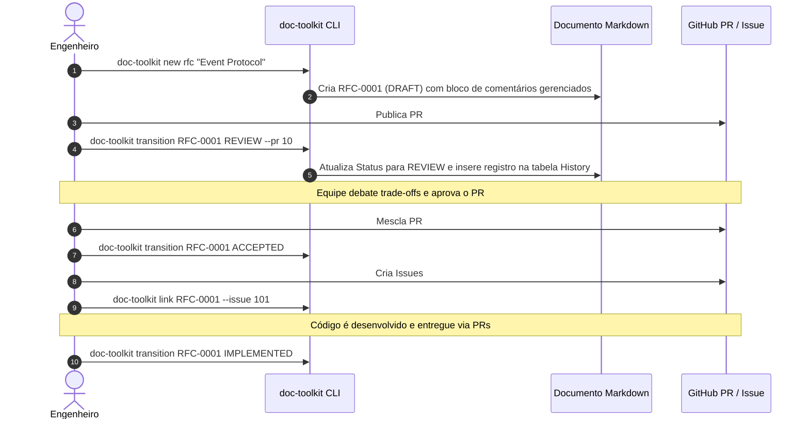

# Mapeamento: Tipos de Documento para Ferramentas do GitHub

O mapeamento entre os tipos de documento do **gh-project-doc-toolkit** e as ferramentas do GitHub foi documentado no repositório.

O guia técnico em inglês está disponível em [`GITHUB_MAPPING.md`](./GITHUB_MAPPING.md) e na [Seção 4 do `README.md`](./README.md#4-mapping-document-types-to-github-tools), além de referenciado nos fluxos de trabalho ([`adrs/workflow.md`](./adrs/workflow.md), [`rfcs/workflow.md`](./rfcs/workflow.md) e [`specs/workflow.md`](./specs/workflow.md)).

---

## 🗺️ Matriz de Mapeamento: Do Documento para as Ferramentas do GitHub

| Tipo de Documento | Fase / Status | Ferramenta Principal do GitHub | Ferramenta Secundária | Ação / Estado no GitHub | Efeito no Documento |
| :--- | :--- | :--- | :--- | :--- | :--- |
| **ADR** (Architecture Decision Record) | `PROPOSED` | **GitHub Pull Request** | GitHub Issue (discussão opcional) | PR aberto com label `adr` | PR associado nos metadados; revisão técnica em andamento |
| **ADR** | `ACCEPTED` | **GitHub Pull Request** | — | PR aprovado e **Merged** | Status fixado em `ACCEPTED`; merge registrado no histórico |
| **ADR** | `REJECTED` | **GitHub Pull Request** | — | PR **Fechado** sem merge | Status marcado como `REJECTED`; motivo arquivado |
| **RFC** (Request for Comments) | `REVIEW` | **GitHub Pull Request** | **GitHub Discussions** | PR aberto com label `rfc` | Discussão de design, sugestões de linha e consenso |
| **RFC** | `ACCEPTED` | **GitHub Pull Request** | — | PR aprovado e **Merged** | Proposta aceita; pronta para desdobramento técnico |
| **RFC** | `IMPLEMENTED` | **GitHub Pull Requests** | **GitHub Issues** (Milestone) | PRs de entrega mesclados; issues de milestone fechadas | Rollout técnico completo no código-fonte |
| **SPEC** (Technical Specification) | `REVIEW` / `APPROVED` | **GitHub Issue / Project** | **GitHub Milestone** | Item priorizado no Project Board / Milestone | Requisitos de negócio e critérios de aceite BDD assinados |
| **SPEC** | `IN_PROGRESS` | **GitHub Issue** | Branch de desenvolvimento | Issue atribuída com label `in-progress` | Engenharia ativa na implementação da especificação |
| **SPEC** | `RESOLVED` / `CLOSED` | **GitHub Pull Request(s)** | **GitHub Releases** | PR(s) de entrega mesclados; testes em CI validados | Critérios de aceite cumpridos; release publicada |

---

## 🔄 Exemplos de Fluxo e Interação



---

## 💾 Persistência nos Comentários do Documento

A associação é registrada de forma autônoma pela ferramenta dentro dos delimitadores HTML:

```markdown
<!-- ===================================================================== -->
<!-- TOOLKIT:MANAGED_START -->
<!--
TOOLKIT:METADATA
id: SPEC-0001
type: spec
title: Public API Rate Limiting Engine
status: IN_PROGRESS
created_at: 2026-10-29T00:00:00Z
updated_at: 2026-10-29T00:30:00Z
authors: ["@techlead"]
github_repo: "owner/repo"
github_issue: 78
github_pr: 95
-->
<!-- ===================================================================== -->

## Status

**Status:** `IN_PROGRESS`  
**GitHub Tracking Issue:** #78 (https://github.com/owner/repo/issues/78)  
**GitHub Delivery PR:** #95 (https://github.com/owner/repo/pull/95)  

<!-- ===================================================================== -->
<!-- TOOLKIT:HISTORY_START -->
## History

| Timestamp (UTC) | From Status | To Status | Actor | Notes / PR Reference |
| :--- | :--- | :--- | :--- | :--- |
| 2026-10-29 00:00 | - | DRAFT | @techlead | Initial spec created |
| 2026-10-29 00:15 | DRAFT | APPROVED | @product | Requirements signed off |
| 2026-10-29 00:30 | APPROVED | IN_PROGRESS | @engineer | Implementation started (Issue #78) |
<!-- TOOLKIT:HISTORY_END -->
<!-- TOOLKIT:MANAGED_END -->
<!-- ===================================================================== -->
```
