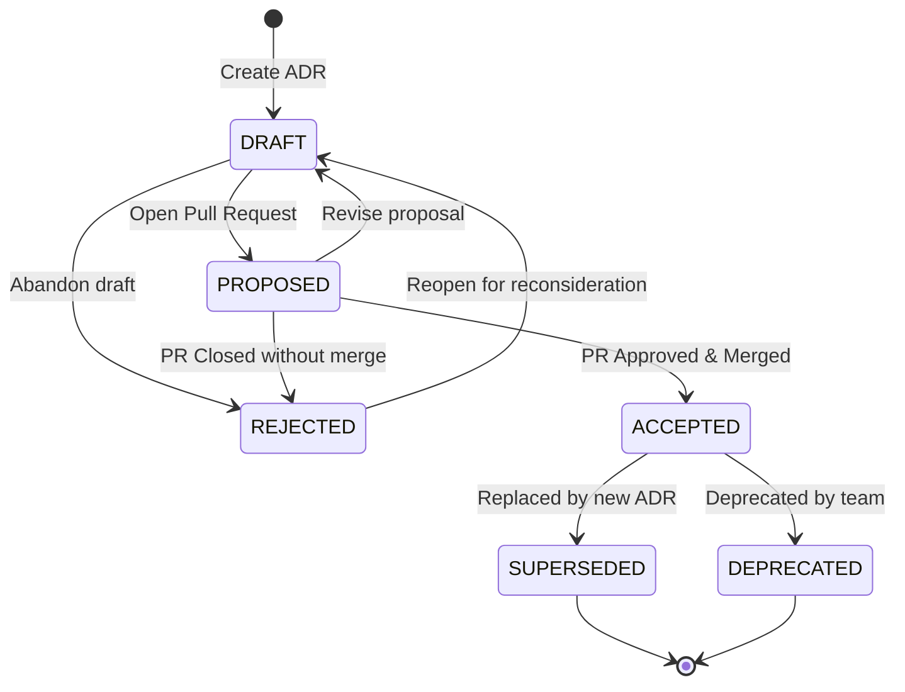

# Architecture Decision Record (ADR) Workflow

This document formally defines the lifecycle, transition rules, and GitHub association guidelines for Architecture Decision Records (ADRs) within this repository. For the overarching architectural guide across all document types, see [GITHUB_MAPPING.md](../GITHUB_MAPPING.md).

---

## 1. Lifecycle States

| State | Description | GitHub Association |
| :--- | :--- | :--- |
| **`DRAFT`** | Initial document drafting. Not yet ready for architectural review. | None or local branch. |
| **`PROPOSED`** | Proposed for review by stakeholders, architects, and peers. | **Required**: Active GitHub Pull Request. |
| **`ACCEPTED`** | Consensus reached; decision is approved and adopted. | Merged Pull Request. |
| **`REJECTED`** | Decision proposal was considered but rejected. | Closed Pull Request (unmerged). |
| **`SUPERSEDED`** | Decision was previously accepted but has been replaced by a newer ADR. | References the replacing ADR ID & PR. |
| **`DEPRECATED`** | Decision is no longer valid or relevant due to architectural evolution. | Associated deprecation PR. |

---

## 2. State Transition Diagram



---

## 3. Transition Rules

1. **Creating an ADR**:
   - Initial state must be `DRAFT` or `PROPOSED`.
   - The file is placed in `doc/adrs/` (or `adrs/`) following the naming convention: `ADR-<0000>-<slug>.md`.

2. **Transitioning to `PROPOSED`**:
   - Requires an associated GitHub Pull Request.
   - The pull request URL and number must be recorded in the managed metadata block.
   - Team members, architects, and code owners conduct architectural review via GitHub PR comments and reviews.

3. **Transitioning to `ACCEPTED`**:
   - Can only occur after the associated GitHub PR is approved and merged.
   - The tool updates the status to `ACCEPTED` and logs the merge commit / PR in the history table.

4. **Transitioning to `REJECTED`**:
   - If the proposal is denied or abandoned, the GitHub PR is closed without merging.
   - The reason for rejection must be recorded in the decision outcome and history section.

5. **Transitioning to `SUPERSEDED`**:
   - An accepted ADR can only be superseded by a new ADR.
   - The superseded ADR's metadata must record `superseded_by: ADR-XXXX`.
   - The new ADR must record `supersedes: ADR-YYYY`.

6. **Transitioning to `DEPRECATED`**:
   - An accepted ADR that is obsolete (e.g., service decommissioned) can be marked `DEPRECATED` with an explanatory note in the history.

---

## 4. Toolkit-Managed Metadata Conventions

Every ADR file contains a standardized comment block managed automatically by `doc-toolkit`:

```markdown
<!-- TOOLKIT:MANAGED_START -->
<!--
TOOLKIT:METADATA
id: ADR-0001
type: adr
title: Use PostgreSQL as Primary Relational Database
status: PROPOSED
created_at: 2026-10-28T22:00:00Z
updated_at: 2026-10-28T22:30:00Z
authors: ["architect@example.com"]
reviewers: ["lead-dev@example.com"]
github_repo: "owner/repo"
github_pr: 42
github_issue: 12
superseded_by: null
supersedes: null
-->
...
<!-- TOOLKIT:HISTORY_START -->
## History
| Timestamp (UTC) | From Status | To Status | Actor | Notes / PR Reference |
| :--- | :--- | :--- | :--- | :--- |
| 2026-10-28 22:00 | - | DRAFT | @author | Initial draft |
| 2026-10-28 22:30 | DRAFT | PROPOSED | @author | Opened PR #42 |
<!-- TOOLKIT:HISTORY_END -->
<!-- TOOLKIT:MANAGED_END -->
```

> [!IMPORTANT]
> Do not manually edit the text inside `<!-- TOOLKIT:MANAGED_START -->` and `<!-- TOOLKIT:MANAGED_END -->`. Use the `doc-toolkit transition` or `doc-toolkit link` commands to perform state changes and update metadata.
