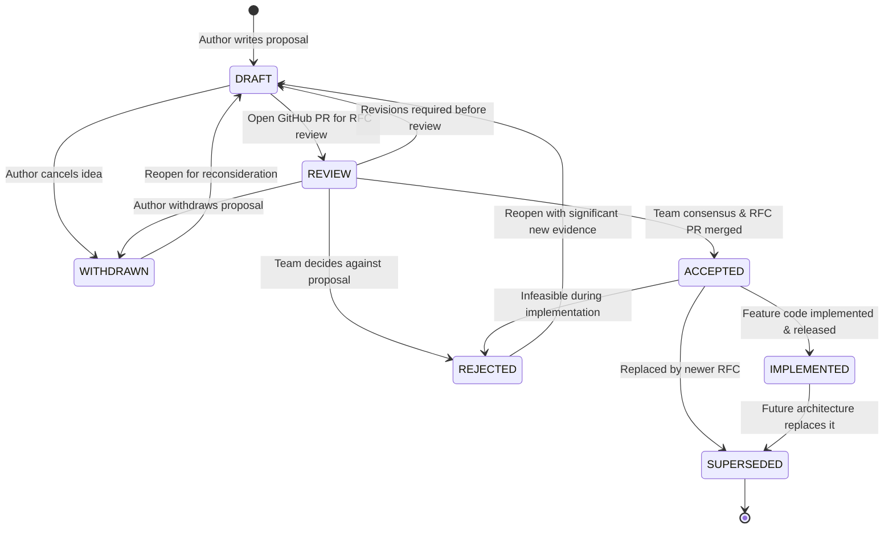

# Request for Comments (RFC) Workflow

This document formally specifies the lifecycle, state transitions, and GitHub tools integration for Request for Comments (RFCs) managed within this toolkit. For the overarching architectural guide across all document types, see [GITHUB_MAPPING.md](../GITHUB_MAPPING.md).

---

## 1. Lifecycle States

| State | Description | GitHub Tools Mapping |
| :--- | :--- | :--- |
| **`DRAFT`** | Initial proposal being drafted by author(s). | Local branch or GitHub Draft PR. |
| **`REVIEW`** | Published for community and peer review. Open for feedback. | Active GitHub Pull Request (or Discussion). |
| **`ACCEPTED`** | Consensus reached; proposal approved and signed off. | Merged RFC Pull Request. |
| **`IMPLEMENTED`** | Technical changes fully developed and deployed into production. | Feature Pull Requests merged; tracking Issue closed. |
| **`REJECTED`** | Proposal reviewed and decided against. | Closed RFC Pull Request (unmerged). |
| **`WITHDRAWN`** | Proposal retracted by author(s). | Closed RFC Pull Request. |
| **`SUPERSEDED`** | Previously accepted proposal replaced by a newer RFC. | References the replacing RFC document & PR. |

---

## 2. State Transition Diagram



---

## 3. Mapping from Document to GitHub Tools

In this architecture, **the RFC document is the source of truth**, and maps out to GitHub tools as follows:

1. **RFC Review Phase (`REVIEW`):**
   - The RFC markdown file is submitted as a GitHub Pull Request.
   - Stakeholders, peers, and tech leads submit comments, line suggestions, and approvals directly on the PR.
   - The CLI tool binds the document to the review PR:
     ```bash
     ./tools/doc-toolkit link rfcs/RFC-0001-feature.md --pr 42
     ```

2. **RFC Consensus Phase (`ACCEPTED`):**
   - When unanimous consent or quorum is reached, the RFC PR is merged into `main`.
   - The status is updated to `ACCEPTED`.

3. **Implementation Phase (`IMPLEMENTED`):**
   - The accepted RFC's rollout tasks are tracked in one or more **GitHub Issues**.
   - Code changes are submitted via one or more **GitHub Pull Requests** that reference the RFC.
   - When all implementation PRs are merged and verification completes, the status moves to `IMPLEMENTED`.

---

## 4. Transition Rules

1. **Creating an RFC:**
   - Stored in `doc/rfcs/` (or `rfcs/`) as `RFC-<0000>-<slug>.md`.
   - Initial state is `DRAFT`.

2. **Transitioning to `REVIEW`:**
   - Requires an active GitHub Pull Request number (`--pr <num>`).

3. **Transitioning to `ACCEPTED`:**
   - Associated GitHub PR must be approved and merged.

4. **Transitioning to `IMPLEMENTED`:**
   - Requires all implementation PRs / tracking issues to be resolved.

5. **Transitioning to `SUPERSEDED`:**
   - Must specify the new RFC ID replacing this proposal.

---

## 5. Toolkit-Managed Metadata Conventions

Every RFC file contains standardized comment blocks managed by `doc-toolkit`:

```markdown
<!-- TOOLKIT:MANAGED_START -->
<!--
TOOLKIT:METADATA
id: RFC-0001
type: rfc
title: Event-Driven Order Processing Architecture
status: REVIEW
created_at: 2026-10-29T00:00:00Z
updated_at: 2026-10-29T00:30:00Z
authors: ["@engineer"]
reviewers: ["@architect"]
github_repo: "owner/repo"
github_pr: 42
github_issue: 15
superseded_by: null
supersedes: null
-->
...
<!-- TOOLKIT:HISTORY_START -->
## History
| Timestamp (UTC) | From Status | To Status | Actor | Notes / PR Reference |
| :--- | :--- | :--- | :--- | :--- |
| 2026-10-29 00:00 | - | DRAFT | @engineer | Created RFC |
| 2026-10-29 00:30 | DRAFT | REVIEW | @engineer | Published for team review (PR #42) |
<!-- TOOLKIT:HISTORY_END -->
<!-- TOOLKIT:MANAGED_END -->
```
