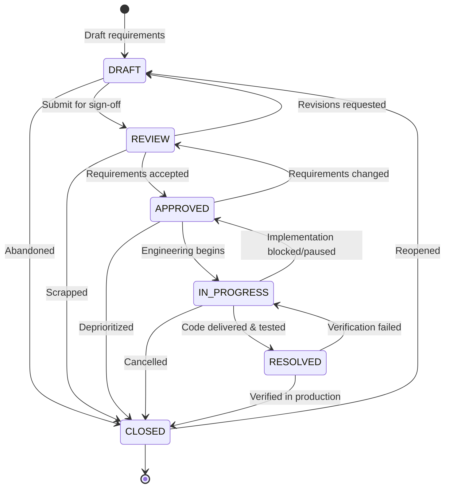

# Technical Specification (SPEC) Workflow

This document formally specifies the lifecycle, state transitions, and GitHub tools integration for Technical and Feature Specifications (SPECs). For the overarching architectural guide across all document types, see [GITHUB_MAPPING.md](../GITHUB_MAPPING.md).

---

## 1. Lifecycle States

| State | Description | GitHub Tools Mapping |
| :--- | :--- | :--- |
| **`DRAFT`** | Initial specification and requirements scoping. | Local branch or draft documentation. |
| **`REVIEW`** | Under review by engineering, product, and QA. | GitHub Pull Request or linked Issue. |
| **`APPROVED`** | Requirements and acceptance criteria agreed and signed off. | GitHub Milestone / Sprint Backlog Issue. |
| **`IN_PROGRESS`** | Active software development underway. | Assigned GitHub Issue, paired with work branch. |
| **`RESOLVED`** | Implementation complete and acceptance criteria verified. | Linked to delivering GitHub Pull Request(s). |
| **`CLOSED`** | Deployed to production, closed, or retired. | Closed GitHub Issue & merged PR. |

---

## 2. State Transition Diagram



---

## 3. Mapping from Document to GitHub Tools

In this workflow, the **SPEC document is the single source of truth** for functional and technical requirements, mapping out to GitHub tools:

1. **Scoping & Sign-Off (`REVIEW` ➔ `APPROVED`):**
   - The spec is reviewed via a documentation PR or discussed on a tracking **GitHub Issue**.
   - Team confirms all acceptance criteria and API contracts.

2. **Delivery Tracking (`IN_PROGRESS`):**
   - The spec is mapped to one or more delivery **GitHub Issues** (for task breakdown, assignments, and milestone tracking).
   - The tool binds the document to the tracking issue:
     ```bash
     ./tools/doc-toolkit link specs/SPEC-0001-feature.md --issue 78
     ```

3. **Code Implementation (`RESOLVED` ➔ `CLOSED`):**
   - Code fulfilling the acceptance criteria is delivered through **GitHub Pull Requests**.
   - The tool associates the delivering PR:
     ```bash
     ./tools/doc-toolkit link specs/SPEC-0001-feature.md --pr 95
     ```
   - When all acceptance criteria pass automated tests in CI, the spec transitions to `RESOLVED`, and then to `CLOSED` after production release.

---

## 4. Transition Rules

1. **Creating a SPEC:**
   - Saved in `doc/specs/` (or `specs/`) as `SPEC-<0000>-<slug>.md`.
   - Initial state is `DRAFT`.

2. **Transitioning to `REVIEW`:**
   - Must contain acceptance criteria and technical architecture sections.

3. **Transitioning to `APPROVED`:**
   - Must have sign-off from tech lead and product owner.

4. **Transitioning to `IN_PROGRESS`:**
   - Requires assigning an engineer (`--actor <name>` or `--assignee <name>`) and linking a GitHub tracking issue (`--issue <num>`).

5. **Transitioning to `RESOLVED`:**
   - Requires referencing the delivering Pull Request (`--pr <num>`).

6. **Transitioning to `CLOSED`:**
   - Verification complete and deployed.

---

## 5. Toolkit-Managed Metadata Conventions

Every SPEC document contains a standardized comment block managed by `doc-toolkit`:

```markdown
<!-- TOOLKIT:MANAGED_START -->
<!--
TOOLKIT:METADATA
id: SPEC-0001
type: spec
title: Public API Rate Limiting Engine
status: IN_PROGRESS
created_at: 2026-10-29T00:00:00Z
updated_at: 2026-10-29T00:30:00Z
authors: ["@techlead"]
assignees: ["@engineer"]
github_repo: "owner/repo"
github_issue: 78
github_pr: 95
priority: "P1"
labels: ["security", "api"]
-->
...
<!-- TOOLKIT:HISTORY_START -->
## History
| Timestamp (UTC) | From Status | To Status | Actor | Notes / PR Reference |
| :--- | :--- | :--- | :--- | :--- |
| 2026-10-29 00:00 | - | DRAFT | @techlead | Initial spec created |
| 2026-10-29 00:15 | DRAFT | APPROVED | @product | Requirements signed off |
| 2026-10-29 00:30 | APPROVED | IN_PROGRESS | @engineer | Implementation started (Issue #78) |
<!-- TOOLKIT:HISTORY_END -->
<!-- TOOLKIT:MANAGED_END -->
```
